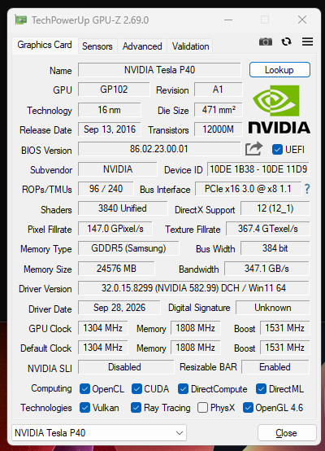

# NVIDIA Tesla P40 WDDM Feature-Gate Bypass (Driver 582.99)

Patches two feature-gates in `nvlddmkm.sys` that block WDDM mode on Tesla P40 (GP102).
Driver 582.99 is the last official NVIDIA branch with Pascal support, so this is the
version this repo targets going forward. Earlier writeups for 551.86 have been removed;
the method and tooling are the same, only the offsets differ between driver builds.

## Background

Up to driver 551.61, WDDM worked on the P40 purely via registry values
(`AdapterType=1`, `GridLicensedFeatures=7`). Starting with 551.86, NVIDIA added a
license/whitelist check in the kernel driver that blocks this path for Tesla cards
without an active GRID Enterprise license, resulting in Windows Error 43.

The registry key `AllowWddmOnTesla` already existed internally before this change
(it's present even in 551.61), but had no real effect until the new check was wired
up. It reads as an internal NVIDIA override meant for their own testing/enterprise
deployment scenarios — this project just forces that override's success path instead
of actually satisfying the license check.

**Note for anyone following an older P40-WDDM registry-bypass tutorial:** most of
those predate 551.86 and only claim to work "up to 551.61". With the driver patch in
this repo applied first, the same registry values those tutorials set
(`AdapterType=1`, `GridLicensedFeatures=7`, etc.) work again on 582.99 — the patch is
what removes the block those older guides don't account for. You don't need a
different registry procedure, just the patched driver underneath it.

## What's patched and why

Two independent changes in the kernel driver, 6 bytes total out of ~110 MB, nothing
else touched:

| Gate | Function | File offset | Original | Patched | What it does |
|---|---|---|---|---|---|
| 1 | Display driver init | `0x7D184` | `B8 56 00 00 00` | `B8 00 00 00 00` | `MOV EAX, 0x56` → `MOV EAX, 0x00`. Forces this init function's return value from an internal error code to success. |
| 2 | `FUN_1414375a0`-equivalent | `0x1815EB4` | `0F 85 5C 01 00 00` | `0F 84 5C 01 00 00` | `JNZ` → `JZ` (one nibble: `85`→`84`). Inverts the branch condition that gates WDDM-on-Tesla. |

**Why Gate 2 is a condition-flip and not a `JMP` rewrite:** this instruction sits
inside a loop. Overwriting it with an unconditional `JMP` (as an earlier, abandoned
approach for 551.86 did) would also remove the loop's normal iteration/exit logic,
not just the one check it was meant to bypass — that risks corrupting unrelated
control flow instead of just the gate. Flipping `JNZ` to `JZ` keeps the instruction
byte-length and the surrounding branch structure identical; only the condition it
tests is inverted. Since the `AllowWddmOnTesla` flag is 0 by default, the inverted
jump now always lands on the success branch.

Gate 1 is not inside a loop, so a direct return-value patch there is safe as-is.

Both offsets were independently verified against the raw driver binary (exact bytes
at the stated file offsets, not just taken from a decompiler listing) before being
used.

## Requirements

- Tesla P40, driver 582.99
- Windows, administrator rights
- Test signing enabled (`bcdedit /set testsigning on`), reboot required
- Secure Boot and HVCI/Memory Integrity must be disabled — the patched driver won't
  load without this even though it's signed, since the signature isn't from NVIDIA

## How to apply

### 1. Enable test signing

```
bcdedit /set testsigning on
```
Reboot.

### 2. Extract the driver

Use 7-Zip to extract the official `582.99` installer into a working folder. You need
`Display.Driver\nvlddmkm.sys` from inside it.

### 3. Patch the driver

```
python patch_p40_wddm.py "Display.Driver\nvlddmkm.sys" "Display.Driver\nvlddmkm.sys"
```

The script verifies the exact original bytes are present at both offsets before
writing anything. If they don't match (wrong driver version, already patched, etc.)
it aborts and writes nothing. Output file is byte-identical to the input except for
the 6 patched bytes — same size, same PE headers.

### 4. Sign the driver

```
powershell -ExecutionPolicy Bypass -File .\sign_driver.ps1 -DriverDir "Display.Driver"
```

Creates a self-signed code-signing certificate (`CN=nv_mod`) in the local machine
store, trusts it, and signs both `nvlddmkm.sys` and the driver's `.cat` file. Both
signing steps must report `Valid`.

### 5. Install the patched driver

Device Manager → Display adapters → NVIDIA Tesla P40 → Update driver → Browse my
computer for drivers → Let me pick from a list → Have Disk → point it at the patched
`Display.Driver` folder → accept the untrusted-publisher warning.

### 6. Enable WDDM in the registry

```
enable_wddm.bat
```

Finds the correct GPU registry subkey automatically and sets `AdapterType=1`,
`GridLicensedFeatures=7`, `EnableMsHybrid=1`, `AllowWddmOnTesla=1`, then resets the
device so the values take effect without a full reboot.

The script finds the card by matching `"Tesla P40"` specifically — in the registry
subkey's `DriverDesc` for the registry step, and via WMI (`Win32_PnPSignedDriver`,
filtered on device name and NVIDIA as manufacturer) for the PnP reset step — instead
of a hardcoded instance ID. This means it works regardless of which PCIe slot the
card is in or how Windows numbered the device this boot, without editing the script,
but it deliberately only matches a P40. If you have other NVIDIA Tesla cards
installed alongside it (M40, P100, etc.), they're ignored; only the P40 gets
touched. Using WMI instead of parsing `pnputil`'s own text output also avoids a
locale problem: `pnputil`'s field labels (e.g. `"Instance ID:"` vs. `"Instanz-ID:"`
on German Windows) differ by display language, while WMI property names don't.

If the script can't find a P40 (wrong driver, device not yet installed, or a name
string your vendor customized), or you want to adapt this for a different Tesla
card, you'll need to adjust the match strings in `enable_wddm.bat`. To find the
right values manually:

- **Registry subkey:** `HKEY_LOCAL_MACHINE\SYSTEM\CurrentControlSet\Control\Class\{4d36e968-e325-11ce-bfc1-08002be10318}`,
  then check each `000x` subkey's `DriverDesc` value in Registry Editor until you find
  your card.
- **PnP instance ID:** run `pnputil /enum-devices /connected` and look for your card's
  entry (vendor `VEN_10DE` = NVIDIA); the `Instance ID` line is what you need.

### 7. Verify

```
nvidia-smi
```

Should show `Tesla P40` (not a generic/garbled name) with `WDDM` in the
`Driver-Model` column, not `TCC`.

For a second, independent confirmation, GPU-Z (`gpuz.png`) also correctly identifies
the card after patching — driver `582.99`, name `NVIDIA Tesla P40`, no generic/garbled
identification:



## Known limitations

- Specific to 582.99. Porting to other versions means re-locating both offsets;
  `AllowWddmOnTesla` is a stable string anchor to start from in Ghidra, but exact
  offsets and surrounding bytes will differ per build.
- Gate 2's `JNZ`→`JZ` flip forces success unconditionally for any card hitting this
  check, not just the P40 — it doesn't discriminate by GPU model. Anyone using this
  patch is implicitly bypassing the license check for Tesla-class WDDM entirely, not
  specifically whitelisting the P40.
- Kernel-mode binary patching. No WHQL certification, test-signing requirement,
  standard risks apply. Use at your own risk.

## TODO (low priority)

- Check whether WDDM can be enabled the "normal" way via `nvidia-smi -dm 0`, the way
  it already works on cards like the M40, instead of requiring the registry hack at
  all.
- Replace the Gate 2 patch with something that doesn't blanket-bypass the license
  check for all GRID-capable cards — e.g. an actual P40-specific condition — so the
  bypass is scoped to this GPU rather than acting as a general license-check
  defeat for anyone with any Tesla/GRID card. Until this is done, treat this patch
  as "disables the Tesla WDDM license check entirely," not as "a P40-specific fix."

## Credits

Ghidra 12.2 (NSA) for disassembly/decompilation. Research and patch development
through a mix of manual Ghidra work and AI-assisted analysis (Claude for structural
verification and sanity-checking offsets against the raw binary, other tools for
decompiler exploration and script generation). The `AllowWddmOnTesla` string was
found by searching the binary for "tesla" by hand.

## License

MIT
